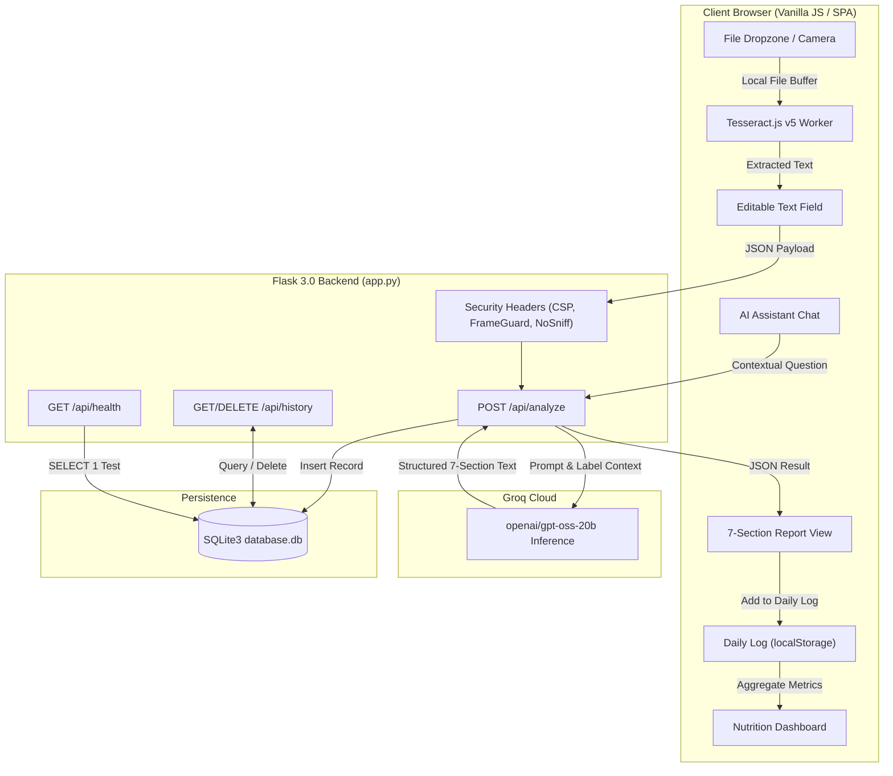

<div align="center">

# PACKS – AI-Powered Packaged Food Analyzer

**Instant nutritional transparency from food labels using client-side OCR and fast LLM intelligence.**

[](https://www.python.org/)
[](https://flask.palletsprojects.com/)
[](https://groq.com/)
[](https://tesseract.projectnaptha.com/)
[](https://www.sqlite.org/)
[](https://gunicorn.org/)
[](https://render.com/)
[](#license)

</div>

---

## Table of Contents

- [Overview](#overview)
- [Key Features](#key-features)
- [Architecture & Data Flow](#architecture--data-flow)
- [Application Workflow](#application-workflow)
- [Technology Stack](#technology-stack)
- [Project Directory Structure](#project-directory-structure)
- [Prerequisites & Installation](#prerequisites--installation)
  - [Windows Installation](#windows-installation)
  - [macOS & Linux Installation](#macos--linux-installation)
- [Environment Configuration](#environment-configuration)
- [Running Locally](#running-locally)
- [API Endpoint Documentation](#api-endpoint-documentation)
- [Database Schema & Data Persistence](#database-schema--data-persistence)
- [Production Deployment](#production-deployment)
  - [Deploying to Render via Blueprint](#deploying-to-render-via-blueprint)
  - [Manual Web Service Setup](#manual-web-service-setup)
  - [Ephemeral vs. Persistent Storage on Render](#ephemeral-vs-persistent-storage-on-render)
- [Interface & Screenshots](#interface--screenshots)
- [Security & Privacy Considerations](#security--privacy-considerations)
- [Current Limitations & Roadmap](#current-limitations--roadmap)
- [Contributing](#contributing)
- [License](#license)

---

## Overview

Modern packaged food labels are often deliberately confusing: marketing claims obscure high sugars, sodium quantities are obfuscated across arbitrary serving sizes, and long lists of industrial additives (preservatives, stabilizers, synthetic colors, artificial sweeteners) remain impenetrable to consumers.

**PACKS** solves this by providing immediate, objective clarity:
1. **Privacy-Preserving OCR**: Food label images are processed directly in the user's browser using [Tesseract.js v5](https://tesseract.projectnaptha.com/) Web Workers. Raw images never leave the device.
2. **Structured Nutrition Breakdown**: The extracted label text is sent to a secured [Flask](https://flask.palletsprojects.com/) API powered by [Groq Cloud](https://groq.com/) LLM inference (`openai/gpt-oss-20b`). The analysis is parsed into a rigorous 7-section breakdown.
3. **Daily Nutrition Tracking**: Users can log analyzed items or manual food entries to monitor daily calories and macronutrient intake (Protein, Carbs, Fat) against a customizable calorie target.
4. **Persistent History & Assistant**: Scans are persisted to a local SQLite database for historical review, while an interactive nutrition assistant answers questions grounded in the active scan context.

---

## Key Features

<details open>
<summary><strong>1. In-Browser OCR Extraction (Tesseract.js v5)</strong></summary>

- **Client-Side Text Recognition**: OCR runs on client hardware using WebAssembly and Web Workers.
- **Zero Raw Image Uploads**: No image files are transferred or stored on the backend, minimizing network overhead and guaranteeing image privacy.
- **Real-Time Progress & Inspection**: Visual progress bar tracks OCR stages (loading core, initializing engine, recognizing text).
- **Editable Transcript**: Extracted text can be corrected or pruned before triggering AI analysis.
</details>

<details open>
<summary><strong>2. Grounded 7-Section Nutrition Intelligence</strong></summary>

PACKS strictly enforces structured AI evaluation to eliminate hallucinations:
- **Product Name**: Extracted brand and product name.
- **Nutrition Facts**: Key macros (Calories, Protein, Carbohydrates, Total Sugar, Fat, Saturated Fat, Fiber, Sodium/Salt).
- **Ingredients Breakdown**: Plain-language explanations of primary ingredients.
- **Additives & Preservatives**: Detection of artificial sweeteners, colors, and emulsifiers.
- **Good Points**: Positive nutritional highlights (e.g. low saturated fat, high fiber).
- **Things to Watch**: Watchouts (e.g. excessive sodium, high added sugars).
- **Quick Verdict**: Objective, conservative summary verdict.
</details>

<details>
<summary><strong>3. Daily Dietary Log & Macro Tracker</strong></summary>

- **Direct Log Integration**: Add foods directly from an analysis report into the daily log with one click.
- **Manual Entry Support**: Log external meals with customizable portions, calories, and macronutrient values.
- **Date Navigation**: Filter logs by specific dates with per-day macro aggregation.
- **CRUD Controls**: Edit quantities or delete individual food records with immediate recalculation.
- **Client Storage**: Log entries persist locally on the user's browser via `localStorage`.
</details>

<details>
<summary><strong>4. Dynamic Nutrition Dashboard</strong></summary>

- **Target Tracking**: Real-time progress bar tracking consumed calories against a customizable daily calorie goal (default: 2000 kcal).
- **Macronutrient Aggregation**: Live calculation of total daily protein (g), carbohydrates (g), and fat (g).
- **Recent Activity Feed**: Chronological list of foods consumed today with timestamps and energy values.
</details>

<details>
<summary><strong>5. Context-Aware AI Nutrition Assistant</strong></summary>

- **Grounded Chat**: Ask questions about ingredients, dietary suitability, or allergen warnings.
- **Active Label Context**: Automatically incorporates active OCR text and product metadata into queries.
- **Defensive UI**: Disables input during query processing to prevent duplicate submissions.
</details>

<details>
<summary><strong>6. Persistent Scan History (SQLite)</strong></summary>

- **Automatic Persistence**: Every completed analysis is safely stored in a local SQLite database (`scans` table).
- **Quick Reopen**: Instant retrieval of full OCR transcripts and structured reports from the sidebar.
- **Individual Record Deletion**: Delete past scans with confirmation prompts and instant UI synchronization.
</details>

<details>
<summary><strong>7. Premium Monochrome Interface</strong></summary>

- **Design Philosophy**: Deep black background (`#000000`), graphite panels (`#111111`, `#1c1c1c`), high-contrast white typography, and subtle borders (`#282828`).
- **Responsive Navigation**: Full desktop sidebar with quick history list and collapsible mobile bottom navigation bar.
- **Zero Heavy Frameworks**: Built entirely with vanilla HTML5, CSS3, and modern JavaScript for maximum speed and zero build-step overhead.
</details>

---

## Architecture & Data Flow



---

## Application Workflow

1. **Upload & Extract**: Select or drag-and-drop a packaged food label image (`PNG`, `JPG`, `WEBP`). Tesseract.js recognizes label text in the browser.
2. **Review OCR**: The extracted text appears in an editable workspace. Correct any scanning artifacts or unreadable words.
3. **Analyze**: Click **Analyse**. The Flask API routes the text to Groq Cloud with a conservative, hallucination-resistant nutrition prompt.
4. **Structured Report**: PACKS parses the AI output into the 7 standard report sections: Product, Nutrition, Ingredients, Additives, Good Points, Things to Watch, and Quick Verdict.
5. **Track Diet**: Click **+ Add to Daily Log** to import the product's macros into your daily diary and monitor progress toward your calorie target.
6. **Chat with AI**: Switch to the **AI Assistant** to ask follow-up questions (e.g. *"Is this keto-friendly?"* or *"What does additive E211 do?"*).
7. **History**: Re-open or delete historical analyses at any time from the sidebar.

---

## Technology Stack

| Layer | Component | Official Documentation | Purpose |
| :--- | :--- | :--- | :--- |
| **Backend Framework** | Flask 3.0+ | [flask.palletsprojects.com](https://flask.palletsprojects.com/) | RESTful API, static file delivery, and routing |
| **WSGI Server** | Gunicorn | [gunicorn.org](https://gunicorn.org/) | Multi-worker production HTTP server |
| **AI Inference** | Groq Cloud SDK | [console.groq.com/docs](https://console.groq.com/docs) | Fast LLM inference with structured nutrition prompts |
| **Client-Side OCR** | Tesseract.js v5 | [tesseract.projectnaptha.com](https://tesseract.projectnaptha.com/) | In-browser optical character recognition via WebAssembly |
| **Relational Database** | SQLite3 | [sqlite.org](https://www.sqlite.org/) | Server-side scan history persistence |
| **Configuration** | python-dotenv | [pypi.org/project/python-dotenv](https://pypi.org/project/python-dotenv/) | Environment variable management |
| **Frontend Runtime** | Vanilla HTML5 / CSS3 / ES6 | [developer.mozilla.org](https://developer.mozilla.org/) | Zero-framework responsive monochrome interface |
| **Cloud Deployment** | Render | [render.com/docs](https://render.com/docs) | Automated Blueprint deployment (`render.yaml`) |

---

## Project Directory Structure

```text
PACKS-sidebar-pages-update/
│
├── .env.example              # Template for local environment variables
├── .gitignore                # Excludes .env, *.db, uploads, and runtime caches
├── app.py                    # Flask application, REST routes, and Groq client
├── render.yaml               # Render Blueprint deployment configuration
├── requirements.txt          # Production Python dependencies
├── README.md                 # Project documentation
│
├── templates/
│   └── index.html            # Complete monochrome SPA (HTML, CSS, JS)
│
└── [Runtime Files - Excluded from Git]
    ├── .env                  # Local secret configuration (ignored)
    └── database.db           # SQLite database file (ignored)
```

---

## Prerequisites & Installation

### Prerequisites
- **Python 3.10+** (Python 3.11 recommended)
- **A Groq API Key**: Obtain a free key from the [Groq Console](https://console.groq.com/).

---

### Windows Installation

1. **Clone the repository**:
   ```powershell
   git clone https://github.com/pranav122005/PACKs.git
   cd PACKs
   ```

2. **Create and activate a virtual environment**:
   ```powershell
   python -m venv venv
   .\venv\Scripts\Activate.ps1
   ```
   *(If script execution is disabled in PowerShell, run `Set-ExecutionPolicy -Scope Process -ExecutionPolicy Bypass` first).*

3. **Install dependencies**:
   ```powershell
   python -m pip install --upgrade pip
   pip install -r requirements.txt
   ```

4. **Configure environment variables**:
   ```powershell
   Copy-Item .env.example .env
   ```
   Open `.env` in your text editor and supply your `GROQ_API_KEY`.

---

### macOS & Linux Installation

1. **Clone the repository**:
   ```bash
   git clone https://github.com/pranav122005/PACKs.git
   cd PACKs
   ```

2. **Create and activate a virtual environment**:
   ```bash
   python3 -m venv venv
   source venv/bin/activate
   ```

3. **Install dependencies**:
   ```bash
   pip install --upgrade pip
   pip install -r requirements.txt
   ```

4. **Configure environment variables**:
   ```bash
   cp .env.example .env
   ```
   Edit `.env` to include your valid `GROQ_API_KEY`.

---

## Environment Configuration

The application reads configuration settings via `python-dotenv` from `.env`. A complete template is provided in [`.env.example`](file:///.env.example):

```env
# Groq AI Cloud Credentials
GROQ_API_KEY=replace_with_your_groq_api_key
GROQ_MODEL=openai/gpt-oss-20b
GROQ_TIMEOUT_SECONDS=30.0

# Database Configuration (Relative or absolute path to SQLite file)
DATABASE_PATH=database.db

# Server Configuration
FLASK_DEBUG=0
PORT=5000
```

| Variable | Required | Default | Description |
| :--- | :---: | :--- | :--- |
| `GROQ_API_KEY` | **Yes** | *None* | Authentication key for Groq Cloud LLM inference. |
| `GROQ_MODEL` | No | `openai/gpt-oss-20b` | Target Groq model identifier. |
| `GROQ_TIMEOUT_SECONDS` | No | `30.0` | Upstream API timeout before failing gracefully. |
| `DATABASE_PATH` | No | `database.db` | Relative or absolute path to SQLite database. |
| `FLASK_DEBUG` | No | `0` | Enable Flask debugger (`1` for dev, `0` for production). |
| `PORT` | No | `5000` | Port for local server or PaaS binding. |

> [!WARNING]
> Never commit real API keys or `.env` files to Git. The `.gitignore` file excludes `.env` and all SQLite database files automatically.

---

## Running Locally

Once configured, start the server:

```bash
python app.py
```

The application will bind to `http://127.0.0.1:5000`. Open this URL in any modern web browser (Chrome, Edge, Firefox, Safari).

---

## API Endpoint Documentation

All backend routes are documented below according to actual implementation in [`app.py`](file:///app.py).

### 1. Web Interface
```http
GET /
```
- **Description**: Delivers the single-page application interface (`templates/index.html`).
- **Response**: `200 OK` (HTML)

---

### 2. AI Product Analysis
```http
POST /api/analyze
Content-Type: application/json
```
- **Description**: Takes label OCR text and optional instructions, queries Groq Cloud, and saves the result to SQLite history.
- **Request Body**:
  ```json
  {
    "text": "NUTRITION FACTS: Calories 150, Total Fat 3g...",
    "product_name": "Almond Crackers",
    "instruction": "Optional custom prompt extension"
  }
  ```
- **Validation Constraints**:
  - Request body maximum size: 2MB (exceeding returns HTTP 413).
  - `text` must contain at least 3 non-whitespace characters (otherwise returns HTTP 400).
  - Maximum OCR text length: 20,000 characters.
- **Success Response (`200 OK`)**:
  ```json
  {
    "success": true,
    "id": 14,
    "product_name": "Almond Crackers",
    "result": "PRODUCT: Almond Crackers\nNUTRITION:\n- Calories: 150 kcal..."
  }
  ```
- **Error Responses**:
  - `400 Bad Request`: Missing or invalid JSON payload.
  - `413 Payload Too Large`: Payload exceeds 2MB limit.
  - `503 Service Unavailable`: `GROQ_API_KEY` is not configured or upstream API is unreachable.
  - `429 Too Many Requests`: Groq Cloud rate limit exceeded.

---

### 3. Scan History List
```http
GET /api/history
```
- **Description**: Returns all saved scans in descending order by creation date.
- **Success Response (`200 OK`)**:
  ```json
  [
    {
      "id": 14,
      "product_name": "Almond Crackers",
      "created_at": "2026-10-30T20:15:00"
    }
  ]
  ```

---

### 4. Scan History Detail
```http
GET /api/history/<int:scan_id>
```
- **Description**: Retrieves a single historical scan including full OCR transcript and AI analysis.
- **Success Response (`200 OK`)**:
  ```json
  {
    "id": 14,
    "product_name": "Almond Crackers",
    "ocr_text": "RAW OCR TEXT...",
    "ai_analysis": "STRUCTURED 7-SECTION ANALYSIS...",
    "created_at": "2026-10-30T20:15:00"
  }
  ```
- **Error Response**: `404 Not Found` if the record does not exist.

---

### 5. Delete Scan Record
```http
DELETE /api/history/<int:scan_id>
```
- **Description**: Permanently removes a scan from the SQLite database.
- **Success Response (`200 OK`)**:
  ```json
  {
    "message": "Scan record deleted successfully."
  }
  ```
- **Error Response**: `404 Not Found` if the record does not exist.

---

### 6. Health & Status Check
```http
GET /api/health
```
- **Description**: Monitors database connectivity and Groq configuration readiness.
- **Success Response (`200 OK`)**:
  ```json
  {
    "status": "ok",
    "database": "SQLite",
    "database_status": "connected",
    "ocr": "Tesseract.js",
    "ai": "Groq",
    "groq_configured": true
  }
  ```
- **Degraded Response (`503 Service Unavailable`)**: Returned if the SQLite database connection check fails.

---

## Database Schema & Data Persistence

### Server-Side Persistence: SQLite (`database.db`)

Historical scans are stored locally in SQLite using parameterized queries:

```sql
CREATE TABLE IF NOT EXISTS scans (
    id INTEGER PRIMARY KEY AUTOINCREMENT,
    product_name TEXT,
    ocr_text TEXT NOT NULL,
    ai_analysis TEXT,
    created_at TEXT NOT NULL
);
```

### Client-Side Persistence: Browser `localStorage`

User-specific dietary tracking data is kept on the client device:
- `packs_calorie_goal`: Numeric string storing the target daily calories (e.g. `"2000"`).
- `packs_daily_logs`: Structured JSON object keyed by date (`YYYY-MM-DD`):
  ```json
  {
    "2026-10-30": [
      {
        "id": "1730312400000",
        "name": "Organic Almond Milk",
        "qty": "1 cup",
        "cal": 30,
        "prot": 1,
        "carb": 1,
        "fat": 2.5,
        "time": "08:30 AM"
      }
    ]
  }
  ```

---

## Production Deployment

### Deploying to Render via Blueprint

PACKS includes a configured [`render.yaml`](file:///render.yaml) file:

1. Push your repository to GitHub.
2. Log in to the [Render Dashboard](https://dashboard.render.com/).
3. Click **New** > **Blueprint** and select your repository.
4. Render will parse `render.yaml` automatically:
   - Sets runtime to **Python**.
   - Executes build: `pip install -r requirements.txt`.
   - Starts production WSGI: `gunicorn --workers 2 --threads 4 --timeout 120 --bind 0.0.0.0:$PORT app:app`.
   - Binds health check to `/api/health`.
5. Enter your `GROQ_API_KEY` under the Environment Variables prompt.
6. Click **Apply**.

---

### Manual Web Service Setup

If deploying without Blueprints:
- **Build Command**: `pip install -r requirements.txt`
- **Start Command**: `gunicorn --workers 2 --threads 4 --timeout 120 --bind 0.0.0.0:$PORT app:app`
- **Health Check Path**: `/api/health`
- **Environment Variables**:
  - `GROQ_API_KEY`: *(Your secret API Key)*
  - `GROQ_MODEL`: `openai/gpt-oss-20b`
  - `FLASK_DEBUG`: `0`
  - `DATABASE_PATH`: `database.db`

---

### Ephemeral vs. Persistent Storage on Render

- **Render Free Tier**: Web services run on ephemeral disks. If your instance restarts or redeploys, the local SQLite database resets. However, all **Daily Logs** and **Calorie Goals** remain safe because they reside in the user's browser `localStorage`.
- **Render Starter Tier (Persistent Disk)**: For permanent server-side SQLite scan history:
  1. Add a Render **Persistent Disk** mounted at `/data` (1GB).
  2. Set environment variable: `DATABASE_PATH=/data/database.db`.
  3. The backend automatically creates `/data/` and initializes `database.db` on boot.

---

## Interface & Screenshots

> *Screenshots can be added here. Replace placeholders with actual images.*

| Workspace | Description | Preview |
| :--- | :--- | :---: |
| **New Scan & OCR** | Drag-and-drop zone with Tesseract.js real-time OCR progress | `[ Screenshot: New Scan Workspace ]` |
| **7-Section Report** | Parsed macros, additives breakdown, positives, and watchouts | `[ Screenshot: Analysis Report ]` |
| **Nutrition Dashboard** | Calorie target ring, macro breakdown, and consumption feed | `[ Screenshot: Dashboard Workspace ]` |
| **Daily Log** | Date picker, macro totals, and editable food consumption table | `[ Screenshot: Daily Log Workspace ]` |
| **AI Assistant** | Context-aware chat grounded in food label data | `[ Screenshot: AI Assistant Chat ]` |

---

## Security & Privacy Considerations

1. **Client-Side Image Privacy**: Raw food label images are parsed inside browser WebAssembly memory via Tesseract.js. No images are sent to or stored on backend servers.
2. **Content-Security-Policy (CSP)**: `app.py` enforces a strict CSP restricting executable scripts to self and verified CDNs (`cdn.jsdelivr.net`, `tessdata.projectnaptha.com`).
3. **MIME & Frame Guarding**: `X-Content-Type-Options: nosniff` and `X-Frame-Options: SAMEORIGIN` prevent MIME confusion and clickjacking.
4. **Input Sanitization & Limits**:
   - 2MB request body ceiling prevents memory exhaustion attacks.
   - Text inputs are sanitized to strip null bytes and enforce character limits.
5. **SQL Injection Defense**: All database operations use SQLite parameterized query bindings (`?`).
6. **Zero Credential Exposure**: The health check endpoint (`/api/health`) exposes only boolean configuration status, never revealing keys or environment values.

---

## Current Limitations & Roadmap

### Current Limitations
- **OCR Accuracy**: OCR performance depends on image sharpness, lighting, and packaging curvature.
- **Language Support**: Default client-side OCR is currently configured for English (`eng`).
- **Single-Tenant Database**: SQLite scan history is shared globally across the local deployment; individual client privacy is maintained through browser-side `localStorage` for dietary logs.

### Planned Roadmap
- [ ] Multi-language OCR support (French, Spanish, German, Hindi).
- [ ] Barcode scanning integration via browser camera.
- [ ] Exportable dietary reports (PDF / CSV format).
- [ ] Allergen profile alerts (customizable warnings for gluten, nuts, dairy, soy).

---

## Contributing

Contributions are welcome! Please follow these steps:

1. **Fork the repository**.
2. **Create a feature branch**:
   ```bash
   git checkout -b feature/your-feature-name
   ```
3. **Commit your modifications**:
   ```bash
   git commit -m "feat(module): add concise feature description"
   ```
4. **Verify tests and syntax**:
   ```bash
   python -m py_compile app.py
   ```
5. **Push to your fork and submit a Pull Request**.

---

## License

Licensing has not yet been specified for this project. All rights are reserved by the repository owner.
